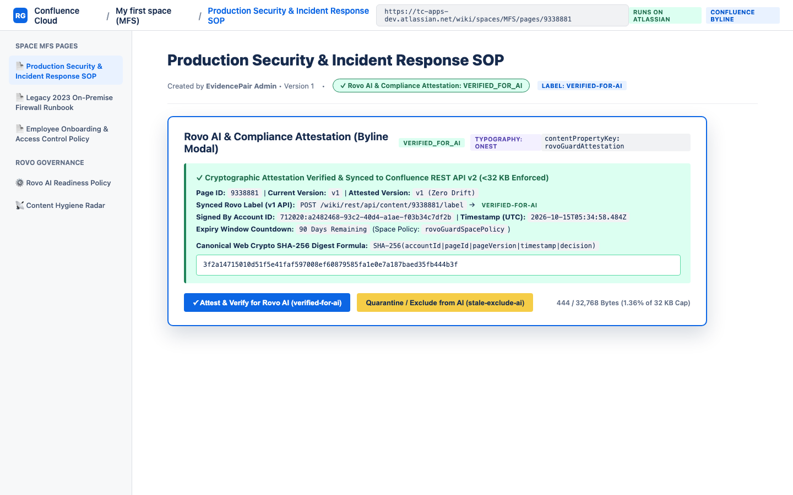
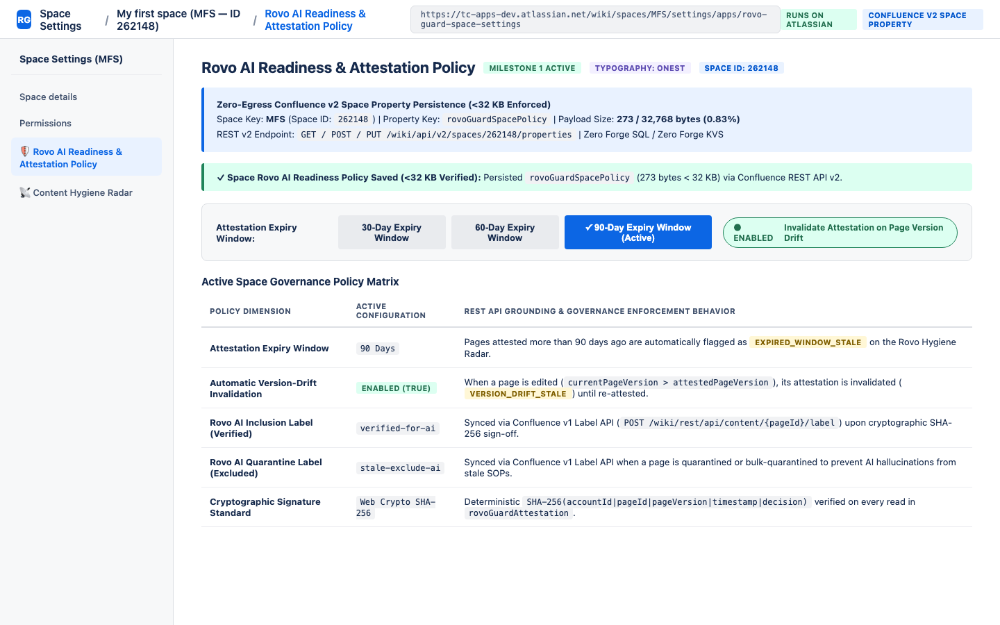
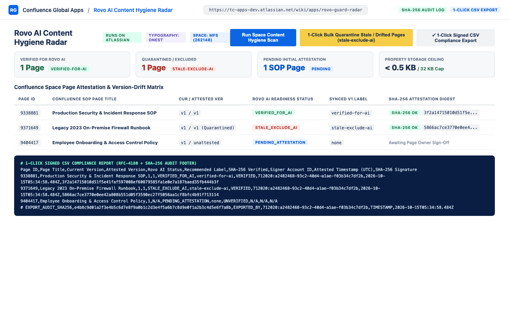

# Page Attestation & Rovo AI Readiness Guard for Confluence — Administrator & Page Owner User Guide

**App Name**: Page Attestation & Rovo AI Readiness Guard for Confluence  
**App Key**: `com.evidencepair.confluence.rovo.guard`  
**App ID**: `ari:cloud:ecosystem::app/8bae494e-64cf-44ba-bfc1-843b7b6eb133`  
**Platform**: Atlassian Forge (`nodejs24.x`) — 100% *Runs on Atlassian* (Zero Data Egress, Zero Forge SQL/KVS)

---

## 1. Overview

Enterprise organizations adopting **Atlassian Rovo AI** face a critical governance challenge: Rovo indexes and retrieves answers from Confluence pages across spaces, including outdated 2023 runbooks, unverified drafts, and SOPs that have drifted across revisions without compliance sign-off.

**Page Attestation & Rovo AI Readiness Guard for Confluence** equips space administrators, compliance officers, and page owners with cryptographic SHA-256 content attestation and automated AI hygiene governance:

1. **Cryptographic Page Sign-Off Byline Modal (`confluence:contentBylineItem` — `rovo-guard-byline`)**: Page owners inspect live attestation status directly beneath the page title and click **Attest & Verify for Rovo AI** or **Quarantine / Exclude from AI**. Computes a deterministic SHA-256 signature (`accountId|pageId|pageVersion|timestamp|decision`), persists it in Confluence Content Property `rovoGuardAttestation` (`<32 KB`), and syncs the `verified-for-ai` or `stale-exclude-ai` label.
2. **Space Rovo AI Readiness & Attestation Policy (`confluence:spaceSettings` — `rovo-guard-space-settings`)**: Space admins configure the attestation expiry window (`30`, `60`, or `90` days), automatic version-drift invalidation toggle (`currentPageVersion > attestedPageVersion`), and Rovo inclusion/exclusion labels in Space Property `rovoGuardSpacePolicy` (`<32 KB`).
3. **Global Rovo AI Content Hygiene Radar (`confluence:globalPage` — `rovo-guard-radar`)**: Scans all pages in a space, detects version drift and expired attestations, executes **1-Click Bulk Quarantine (`stale-exclude-ai`)** with SHA-256 audit logging, and exports a signed **RFC-4180 Compliance CSV Report**.

---

## 2. Cryptographic Page Sign-Off Byline Modal (`Rovo AI & Compliance Attestation`)

Open any Confluence page and click **Rovo AI & Compliance Attestation** in the page byline:
- **Attest & Verify for Rovo AI (`VERIFIED_FOR_AI`)**:
  - Computes `SHA-256(accountId + "|" + pageId + "|" + pageVersion + "|" + timestamp + "|VERIFIED_FOR_AI")`.
  - Stores the signed attestation in `/wiki/api/v2/pages/{pageId}/properties` (`rovoGuardAttestation`, `<32 KB` enforced).
  - Applies the `verified-for-ai` label (and removes `stale-exclude-ai`) via `/wiki/rest/api/content/{pageId}/label`.
- **Quarantine / Exclude from AI (`STALE_EXCLUDE_AI`)**:
  - Signs the quarantine decision with SHA-256 and applies the `stale-exclude-ai` label so admins and Rovo workflows can filter out deprecated runbooks.

---

## 3. Configuring Space Rovo AI Readiness & Attestation Policy

Navigate to **Space Settings -> Apps -> Rovo AI Readiness & Attestation Policy**:
- **Attestation Expiry Window**: Select **30 Days**, **60 Days**, or **90 Days (Default)**. Pages whose attestation timestamp exceeds this window are automatically flagged as `EXPIRED_WINDOW_STALE`.
- **Invalidate Attestation on Page Version Drift**: When enabled (`true`), any edit to a page that increments `currentPageVersion` above `attestedPageVersion` automatically transitions the page to `VERSION_DRIFT_STALE` until a page owner re-attests the new version.
- Persisted natively in `/wiki/api/v2/spaces/{spaceId}/properties` (`rovoGuardSpacePolicy`, `<32 KB` enforced).

---

## 4. Global Rovo AI Content Hygiene Radar, Bulk Quarantine & CSV Export

Navigate to **Apps -> Rovo AI Content Hygiene Radar**:
1. Click **Run Space Content Hygiene Scan** to audit every page in the space against your policy window and version-drift rules.
2. Click **1-Click Bulk Quarantine Stale / Drifted Pages (`stale-exclude-ai`)** to quarantine all drifted or expired pages in one action with full SHA-256 cryptographic audit logging.
3. Click **1-Click Signed CSV Compliance Export** to generate an RFC-4180 compliance report complete with per-page SHA-256 attestation hashes and a signed `# EXPORT_AUDIT_SHA256` footer row for SOC 2 / ISO 27001 / AI governance audits.

---

## 5. Support & Contact
For technical support or security inquiries, contact **EvidencePair LLC** at `support@titlecovenant.com`.
