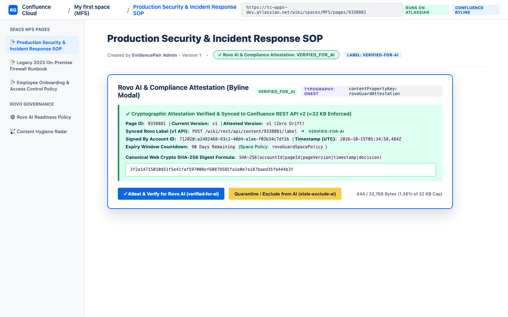
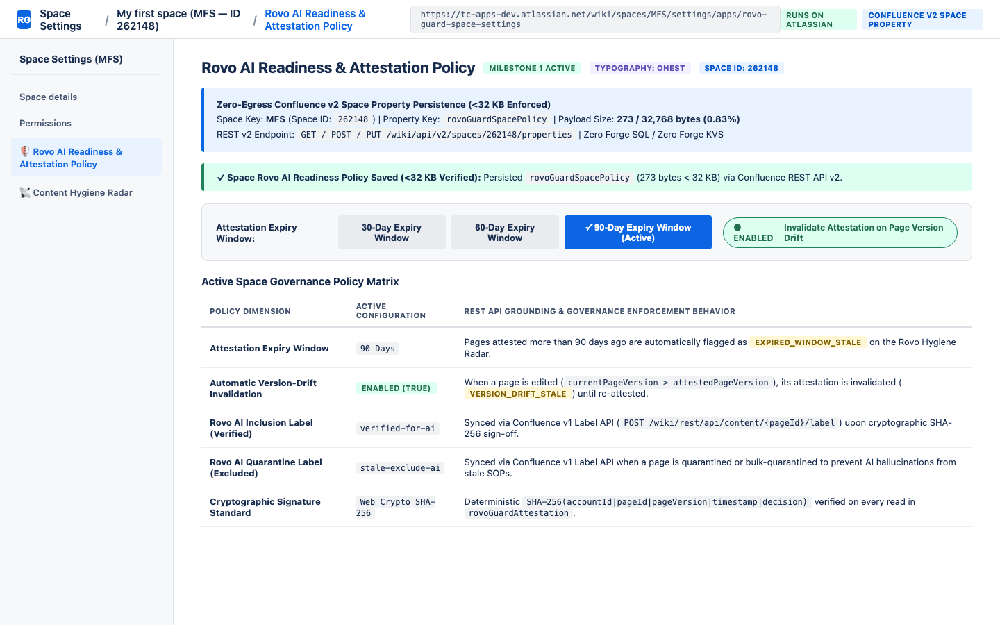
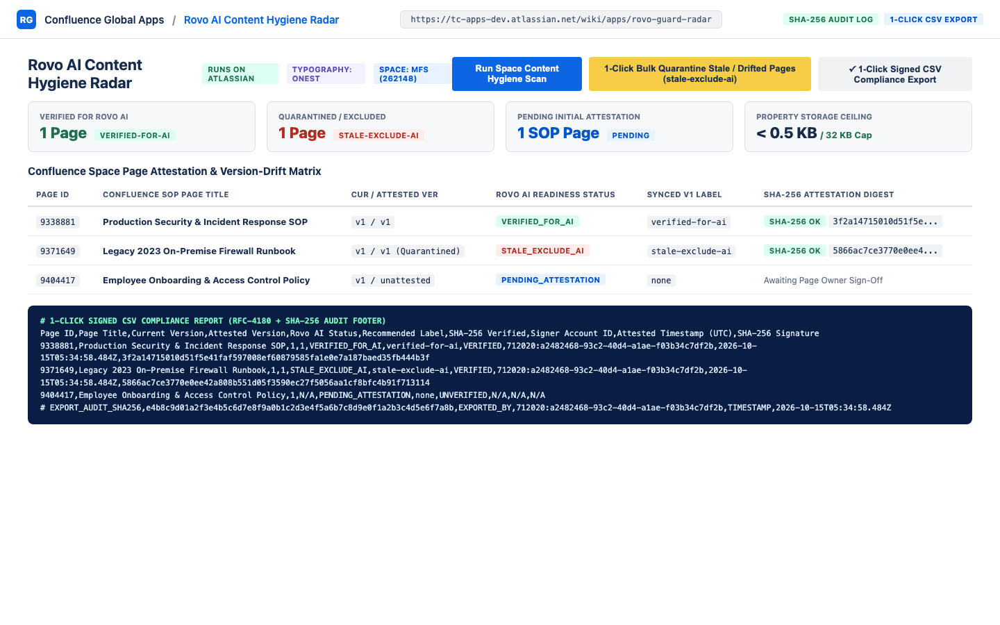

# Page Attestation & AI Readiness Check for Confluence — Administrator & Page Owner User Guide

Updated 10 November 2026

**App Name**: Page Attestation & AI Readiness Check for Confluence  
**App Key**: `com.evidencepair.confluence.rovo.guard`  
**App ID**: `ari:cloud:ecosystem::app/8bae494e-64cf-44ba-bfc1-843b7b6eb133`  
**Platform**: Atlassian Forge (`nodejs24.x`) — 100% *Runs on Atlassian* (Zero Data Egress, Zero Forge SQL/KVS)

---

## 1. Overview

Enterprise organizations adopting **Atlassian Rovo AI** face a critical governance challenge: Rovo indexes and retrieves answers from Confluence pages across spaces, including outdated 2023 runbooks, unverified drafts, and SOPs that have drifted across revisions without compliance sign-off.

**Page Attestation & AI Readiness Check for Confluence** equips space administrators, compliance officers, and page owners with cryptographic SHA-256 content attestation and automated AI hygiene governance:

1. **Cryptographic Page Sign-Off Byline Modal (`confluence:contentBylineItem` — `rovo-guard-byline`)**: Page owners inspect live attestation status directly beneath the page title and click **Attest & Verify for Rovo AI** or **Quarantine / Exclude from AI**. Computes a deterministic SHA-256 signature (`accountId|pageId|pageVersion|timestamp|decision`), persists it in Confluence Content Property `rovoGuardAttestation` (`<32 KB`), and syncs the `verified-for-ai` or `stale-exclude-ai` label.
2. **Space AI Readiness & Attestation Policy (`confluence:spaceSettings` — `rovo-guard-space-settings`)**: Space admins configure the attestation expiry window (`30`, `60`, or `90` days) and the automatic version-drift invalidation toggle (`currentPageVersion > attestedPageVersion`), stored with the Rovo inclusion/exclusion labels in Space Property `rovoGuardSpacePolicy` (`<32 KB`).
3. **Global AI Readiness Radar (`confluence:globalPage` — `rovo-guard-radar`)**: You choose a space you can see. It scans up to 50 pages in that space, detects version drift and expired attestations, executes **1-Click Bulk Quarantine (`stale-exclude-ai`)** with SHA-256 audit logging, and exports a signed **RFC-4180 Compliance CSV Report**.

---

## 2. Cryptographic Page Sign-Off Byline Modal (`Page Attestation & AI Readiness Check for Confluence`)

Open any Confluence page and click **Page Attestation & AI Readiness Check for Confluence** in the page byline. The app works on that page and uses the policy of that page's space:
- **Attest & Verify for Rovo AI (`VERIFIED_FOR_AI`)**:
  - Computes `SHA-256(accountId + "|" + pageId + "|" + pageVersion + "|" + timestamp + "|VERIFIED_FOR_AI")`.
  - Stores the signed attestation in `/wiki/api/v2/pages/{pageId}/properties` (`rovoGuardAttestation`, `<32 KB` enforced).
  - Applies the `verified-for-ai` label (and removes `stale-exclude-ai`) via `/wiki/rest/api/content/{pageId}/label`.
- **Quarantine / Exclude from AI (`STALE_EXCLUDE_AI`)**:
  - Signs the quarantine decision with SHA-256 and applies the `stale-exclude-ai` label so admins and Rovo workflows can filter out deprecated runbooks.
- The record holds the account ID of the person who clicked. If Confluence refuses to save the record, for example because you cannot edit the page, the app says so and changes no labels.

---

## 3. Configuring the Space AI Readiness & Attestation Policy

In the space, open **Space settings**, then **Page Attestation & AI Readiness Check for Confluence** under **Integrations**. The screen shows the space's name, key and ID, read from Confluence. Until someone saves a setting, the default policy applies: 90 days, version-drift check on.
- **Attestation Expiry Window**: Select **30 Days**, **60 Days**, or **90 Days (Default)**. Pages whose attestation timestamp exceeds this window are automatically flagged as `EXPIRED_WINDOW_STALE`.
- **Invalidate Attestation on Page Version Drift**: When enabled (`true`), any edit to a page that increments `currentPageVersion` above `attestedPageVersion` automatically transitions the page to `VERSION_DRIFT_STALE` until a page owner re-attests the new version.
- Persisted natively in `/wiki/api/v2/spaces/{spaceId}/properties` (`rovoGuardSpacePolicy`, `<32 KB` enforced), with the space's own key and the account ID of the person who saved it.

---

## 4. Global AI Readiness Radar, Bulk Quarantine & CSV Export

Navigate to **Apps -> Page Attestation & AI Readiness Check for Confluence**:
1. Choose a space in **Space to scan**. The list holds the spaces you can see (up to 500), sorted by name. The app scans nothing until you choose.
2. The app scans the first 50 pages Confluence returns for that space, against that space's policy window and version-drift rules. The top of the page shows the space's name, key and ID. Click **Run Space Content Hygiene Scan** to scan it again.
3. Click **1-Click Bulk Quarantine Stale / Drifted Pages (`stale-exclude-ai`)** to quarantine, in one action, the scanned pages that need it: pages edited after sign-off, past the expiry window, or whose record no longer matches its checksum. If a page cannot be quarantined, the app names it and carries on with the rest.
4. Click **1-Click Signed CSV Compliance Export** to generate an RFC-4180 compliance report complete with per-page SHA-256 attestation hashes and a signed `# EXPORT_AUDIT_SHA256` footer row for SOC 2 / ISO 27001 / AI governance audits. The CSV appears on the page, ready to copy.

---

## 5. When the app shows a message instead

- **No page to check** or **No space to configure**: Confluence did not say which page or space this is. Open the app from a page's byline or from a space's settings.
- **Choose a space**: on the global page, pick a space first.
- **Confluence says you do not have permission**: Confluence refused the request. Ask a space administrator for the permission named in the message.

---

## 6. Support & Contact
For technical support, contact **EvidencePair LLC** at <https://evidencepair.com/support/> (`support@evidencepair.com`). We reply within one business day. To report a security issue, email `security@evidencepair.com`.
